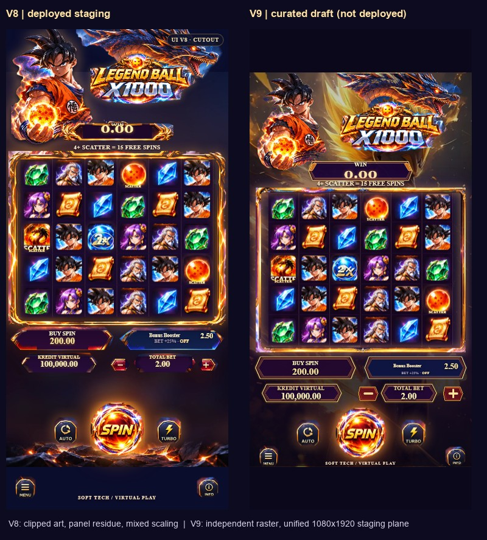
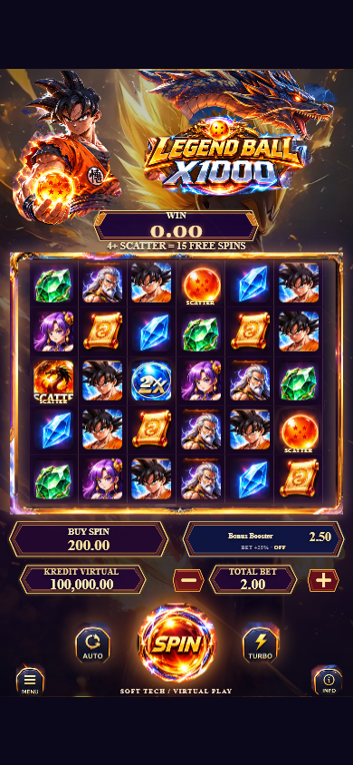
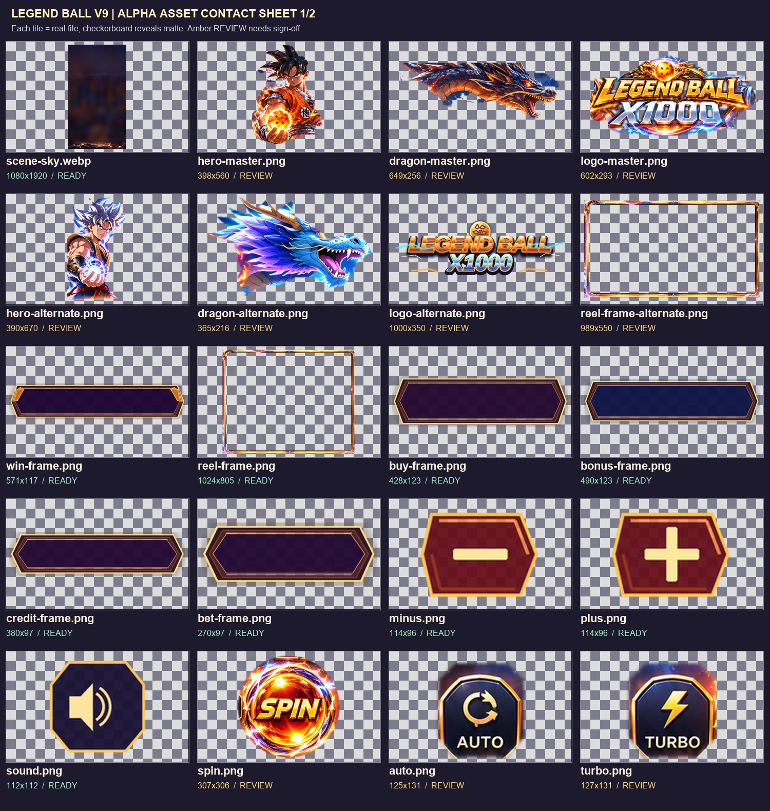
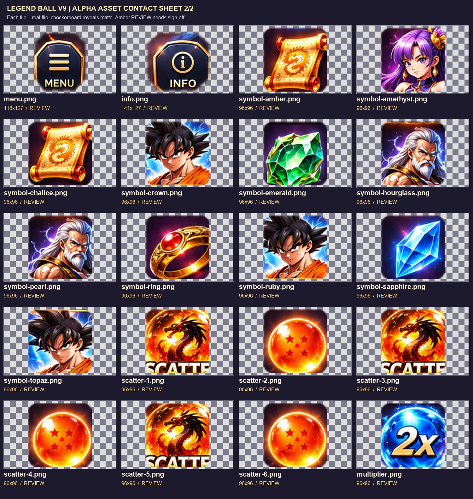

# LEGEND BALL X1000 | V9 Curated Asset Review

**Review state:** VISUAL_REVIEW_REQUIRED | **Deployment:** NOT DEPLOYED | **Baseline:** V8 Railway staging at commit `acfa4f4`.

This branch is intentionally isolated. It must not be merged into `feat/approved-master-ui-v5-20261113` or deployed to Railway until the artwork review is accepted. Game mode remains virtual credits only.

## What has actually changed

V7/V8 used screenshot-derived PNG rectangles with sky, hair, dragon and currency labels baked into the artwork. The new `studio/assets/legend-v9/` contains **40 independently addressable PNG/WebP assets** with a versioned manifest, SHA-256 and alpha metadata, plus a `catalog.js` for Universal Studio's library.

- **New clean transparent raster skins**: Buy Spin, Bonus Booster, WIN, Credit and Bet frames, standalone minus, plus and sound. No frozen numbers or rectangular JPEG fragments inside these panels.
- **Preserved gold ornament**: reel frame built from a native alpha source with **nine-slice geometry**, maintaining ornate corners while scaling the plain edges. Center is transparent.
- **Character, dragon, premium logo**: improved alpha-cutout candidates from the approved flattened artwork; 3 originals still **REVIEW**. Alternate original standalone imagery is also included separately for comparison. Do not represent automatic masks as finished source PSDs.
- **Reel symbols**: original independent PNGs retained; their designed square tile backgrounds are intentional and should not be force-stripped.
- **No visible or hidden SVG UI icons**: legacy hidden splash SVG markup removed; approved splash JPEG and native accessible PLAY button retained.

## Screenshots and evidence









[View the 16 key assets at larger size](V9_CANDIDATE_CONTACT_SHEET.jpg)

Images are generated from true browser render captures and raster files. They are **not AI composited mockups**.

## One coordinate system

Source of truth `studio/project.json` uses one 1080 by 1920 design grid for ALL art and button layers. `play/legend/curated-v9.js` sets X, Y, width, height and rotation directly in container-width units. No `topOffset`, `featureTop`, `walletTop` or mixed %-height overlay rules. One 6x5 reel grid is constrained to square tile geometry.

Studio can add a new V9 cutout as an independent layer, then move and resize logo without overwriting other layers. Numeric values are live DOM bindings; panel artwork never includes numerals. All user interaction buttons remain real HTML elements.

## Tested locally on TRADEVICEPC

| Gate | Outcome |
| --- | --- |
| Existing game, settings, editor, auth and security regressions | **119 / 119 PASS** |
| Locked master JPEG, shared layout and untouched math source | **5 / 5 PASS** |
| Approved JPEG splash and real seeded Spin | **PASS** |
| V9 browser: 320, 390, 430 and 864 px in Chromium | **PASS** |
| V9 browser: 320, 390, 430 and 864 px in Safari/WebKit | **PASS** |
| 6 columns by 5 rows, each tile square | **PASS** |
| No SVG UI icons, no broken images, bet +/- and Spin | **PASS** |
| Studio add layer, edit X and Width, renderer responds | **PASS** |
| Contact sheet matte review | **PENDING SIGN-OFF** |
| Physical iPhone comparison of premium hero/logo cutouts | **PENDING** |
| Commercial rights review of source artwork | **PENDING** |

## Important QA distinction

- "RGBA exists" alone does **not** make a cutout clean. Each approved art asset needs contour checks against contrasting checkerboards, detached color-halo checks, and inspection of composited result at 100% and 200% zoom.
- The premium hero/dragon/logo are still derived from a flattened JPEG. A source PSD/AI or higher-resolution licensed originals would improve hair and electric glow edges. The alternative original art changes the look, so it was **not substituted without approval**.
- Do **not** use passing functional tests as proof of final visual quality.

## Release checklist

Only after the three premium matte candidates are approved, confirm the final reel/controls composition against the master JPEG at native iPhone sizes, confirm tap target usability and source rights, run the suites again, then make a reviewed merge to staging. V8 staging remains available and unaffected.

To reproduce review assets (on the development workstation):

```bash
python scripts/build-legend-v9-assets.py
python scripts/wire-legend-v9.py
node scripts/prepare-play.mjs
node scripts/tests/curated-v9-browser.mjs
node scripts/tests/curated-v9-studio.mjs
```

**No background production release has been requested or performed.**
